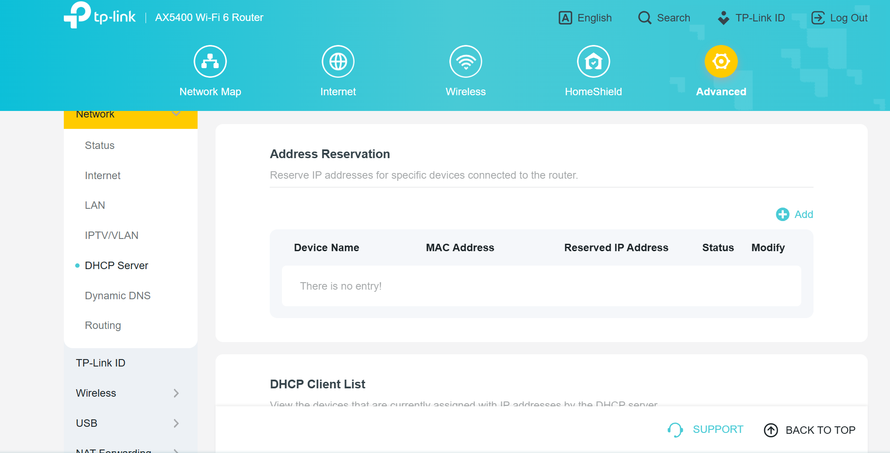
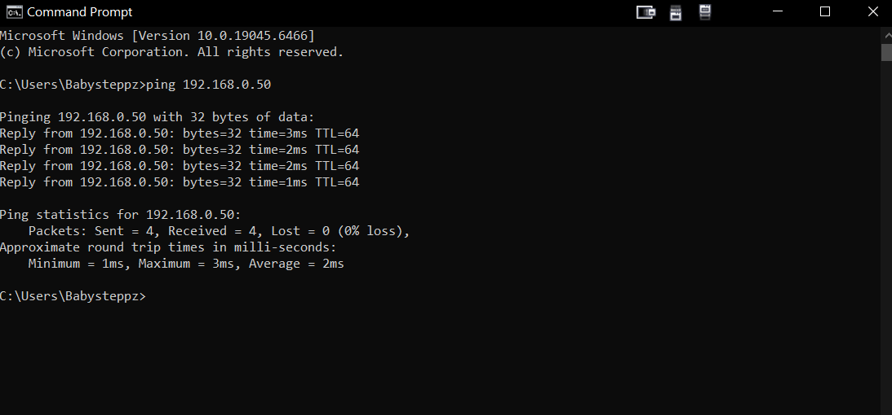
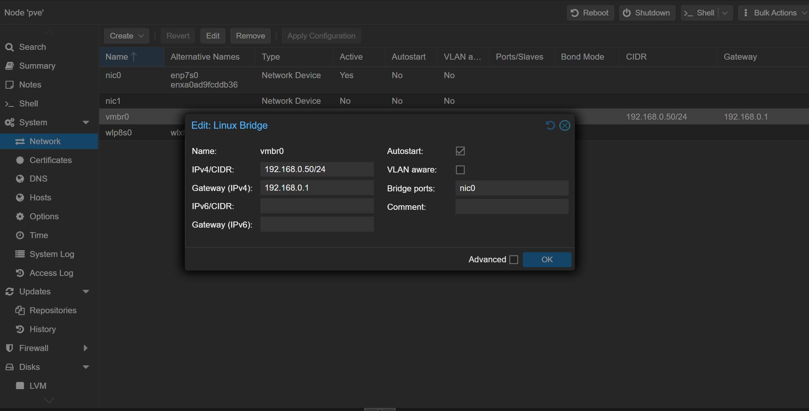
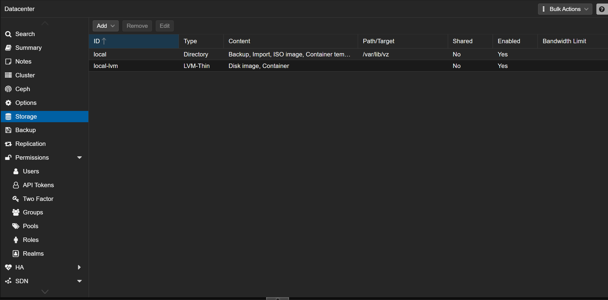
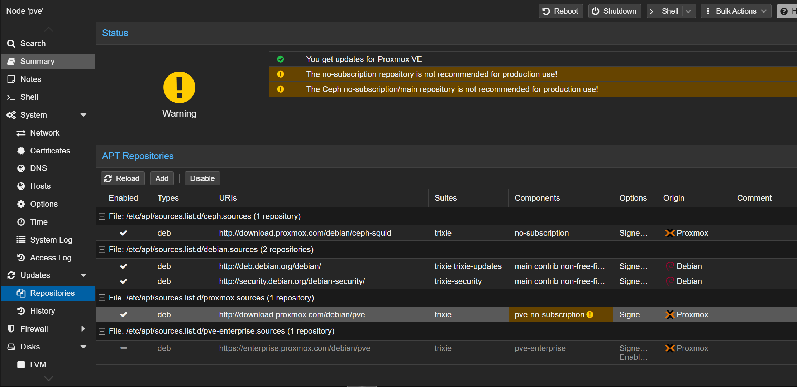
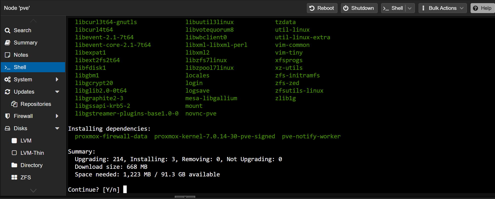
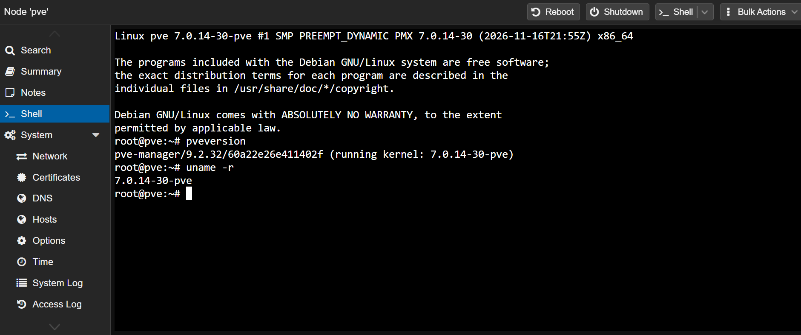
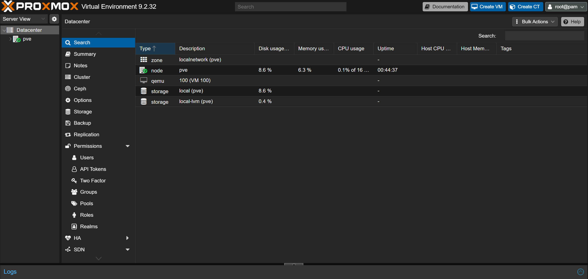

# 02 – Proxmox Installation & Configuration

## Overview

After completing the hardware build, I installed Proxmox VE on my home server.

My goal was to create a home lab where I could run multiple virtual machines, practise networking, learn Linux administration and develop my IT troubleshooting skills.

## 1. Proxmox Installation

I created a bootable USB and installed Proxmox VE onto my 2TB NVMe SSD.

During the installation, I completed the following:

- Prepared the bootable USB.
- Configured the BIOS boot settings.
- Selected the installation drive.
- Set the server hostname.
- Configured the network settings.
- Accessed the Proxmox web interface from my Windows PC.

This was my first experience setting up a dedicated virtualisation server on physical hardware, having previously worked with virtual machines using VirtualBox and HYPER V.

## 2. Network Configuration

I assigned a static IP address to my Proxmox server so I could access it using the same IP address. I also configured the Linux bridge (vmbr0) to allow virtual machines to connect to my home network.

| Configuration | Value |
|---|---|
| Hostname | pve.home.arpa |
| IP Address | 192.168.0.50 |
| Subnet | /24 (255.255.255.0) |
| Default Gateway | 192.168.0.1 |
| DNS Server | 192.168.0.1 |
| Network Bridge | vmbr0 |
| Management Port | 8006 |

### DHCP Reservation

I set up a DHCP reservation on my router to reserve the IP address used by my Proxmox server and help prevent IP address conflicts.



### Network Connectivity Test

I used the ping command to test the network connection and check that the server was reachable.




### Linux Bridge (vmbr0)

Having previously worked with virtual machines in VirtualBox, I was already familiar with virtual networking. Setting up Proxmox allowed me to apply this knowledge to a dedicated physical server.

The Linux bridge (vmbr0) allows virtual machines to communicate with my home network through the server's physical Ethernet interface.




## 3. Storage Configuration

Proxmox was installed on my Lexar NM990 2TB NVMe SSD.

While exploring the storage settings, I learned that Proxmox separates storage for general files and virtual machine disks.

| Storage | Type | Purpose |
|---|---|---|
| local | Directory | ISO files, container templates and backups |
| local-lvm | LVM-Thin | Virtual machine and container disks |



This helped me understand how Proxmox manages storage when creating virtual machines.

## 4. Repository Configuration

When I first attempted to update Proxmox, I encountered HTTP 401 errors.

After investigating the issue, I learned that the enterprise repositories require a paid subscription.

Since this server is being used as a home lab, I disabled the enterprise repository and configured the no-subscription repositories.

My current repository configuration includes:

- Proxmox VE no-subscription repository.
- Ceph Squid no-subscription repository.
- Debian Trixie repositories.
- Debian security repository.
- Disabled Proxmox enterprise repository.



The yellow warnings are expected because the no-subscription repositories are not recommended for production environments.

This helped me understand the purpose of software repositories and the difference between subscription-based and no-subscription repositories.

## 5. System Updates

After fixing the repository issues, I used the following commands to update the server:

```bash
apt update
apt full-upgrade
```



### Version Verification

After completing the updates, I checked the installed Proxmox version.



## 6. Troubleshooting

During the installation and setup, I encountered several issues that gave me an opportunity to practise troubleshooting.

| Issue | What I learned or how I resolved it |
|---|---|
| Incorrect installation media | Learned the difference between ARM64 and AMD64/x86-64 architecture and used the correct installation media. |
| Ethernet connectivity issue | Checked the physical connection and network settings. |
| HTTP 401 repository error | Learned that the enterprise repository requires a subscription and configured the no-subscription repository instead. |
| Ceph repository error | Changed the Ceph repository to the no-subscription version. |

Working through these issues helped me become more comfortable investigating errors, identifying possible causes and testing solutions.

## 7. Final Result

After completing the installation, network configuration and system updates, I was able to successfully access and manage my Proxmox server through the web interface.



### Completion Checklist

- [x] Installed Proxmox VE
- [x] Configured a static IP address
- [x] Configured DHCP reservation
- [x] Tested network connectivity
- [x] Configured the Linux bridge
- [x] Reviewed storage configuration
- [x] Fixed repository errors
- [x] Completed system updates
- [x] Verified access to the web interface

## Skills Developed

- Hypervisor installation
- Virtualisation fundamentals
- IP addressing and subnetting
- DHCP reservation
- Basic network troubleshooting
- Linux network bridging
- Storage management fundamentals
- Linux command-line usage
- Package and repository management
- Technical documentation

## What I Learned

This project helped me gain a better understanding of how a virtualisation server works and how networking, storage and operating systems work together.

It also gave me practical experience troubleshooting issues rather than simply following installation instructions.

I now have a working home lab that I can continue using to develop my IT skills.

## Next Phase

My next step is to deploy an Ubuntu Server virtual machine, configure SSH for remote access and practise Linux server administration.

---

[Return to Project Overview](../README.md)
