# 03 – Ubuntu Server Deployment & Configuration

## Overview

After setting up my Proxmox server, I deployed an Ubuntu Server virtual machine to practise Linux administration and remote server management.

Having previously worked with virtual machines using VirtualBox, I wanted to expand my experience by managing virtual machines on a dedicated physical server.

## 1. Preparing the Ubuntu ISO

I uploaded the Ubuntu Server ISO to Proxmox's local storage to use as the installation media.

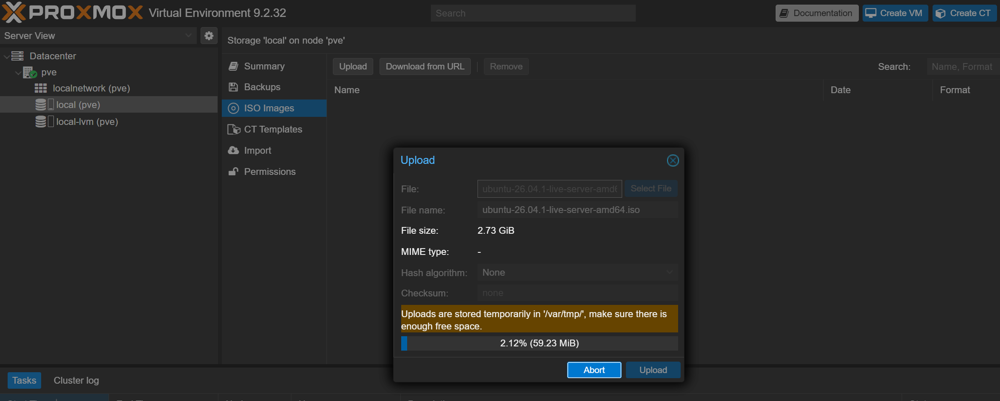

## 2. Creating the Virtual Machine

I created a new virtual machine in Proxmox and allocated the CPU, memory and storage required to run Ubuntu Server.

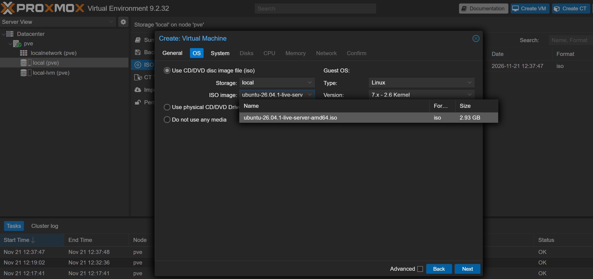

### Virtual Machine Specifications

| Configuration | Value |
|---|---|
| VM ID | 100 |
| VM Name | ubuntu-server |
| Operating System | Ubuntu Server |
| CPU | 2 Cores |
| RAM | 4GB |
| Disk Storage | 32GB |
| Disk Controller | VirtIO SCSI |
| Network Bridge | vmbr0 |
| Network Adapter | VirtIO |

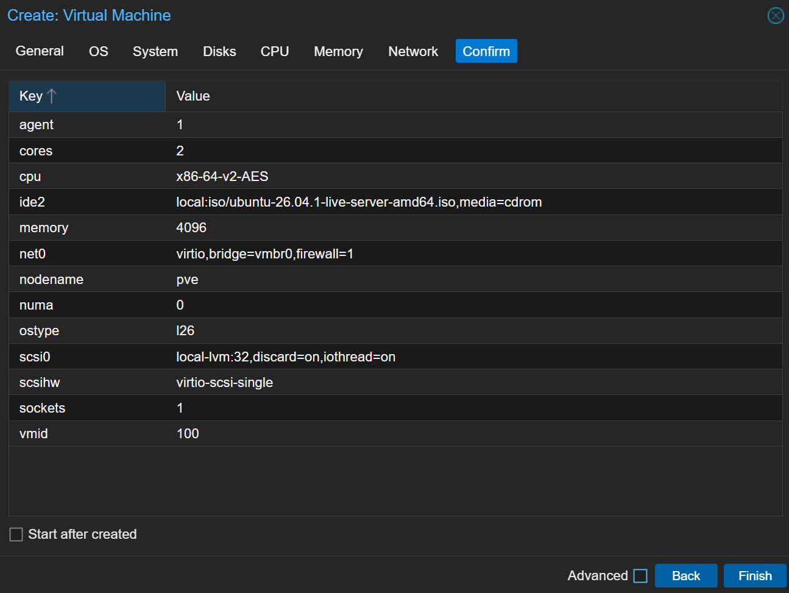

### Virtual Network Configuration

I connected the virtual machine to the vmbr0 network bridge so Ubuntu Server could communicate with other devices on my home network.

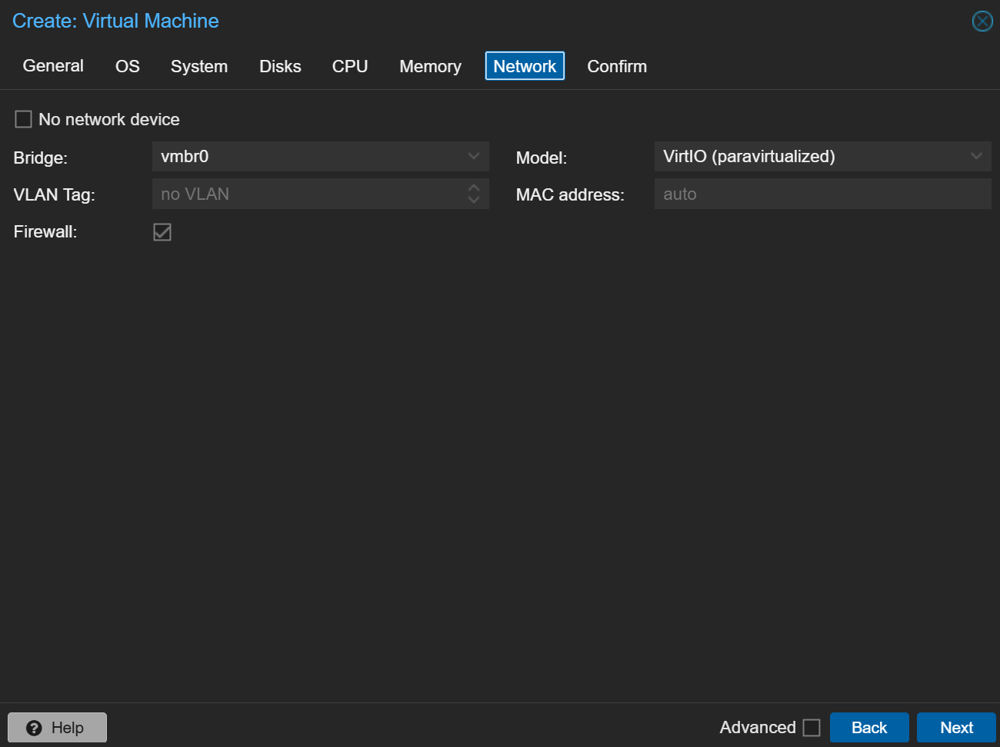

## 3. Ubuntu Server Installation

After creating the virtual machine, I booted from the Ubuntu Server ISO and proceeded with the installation.

### Network Configuration

I used DHCP to automatically obtain the network settings from my router.

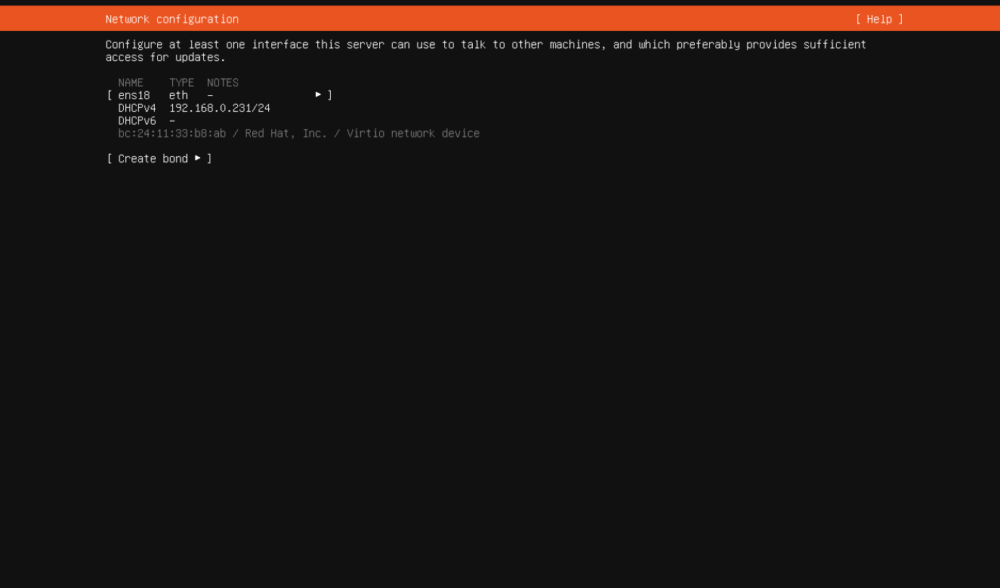

### Guided Storage Configuration

I selected the guided storage option to install Ubuntu Server onto the allocated 32GB virtual disk.

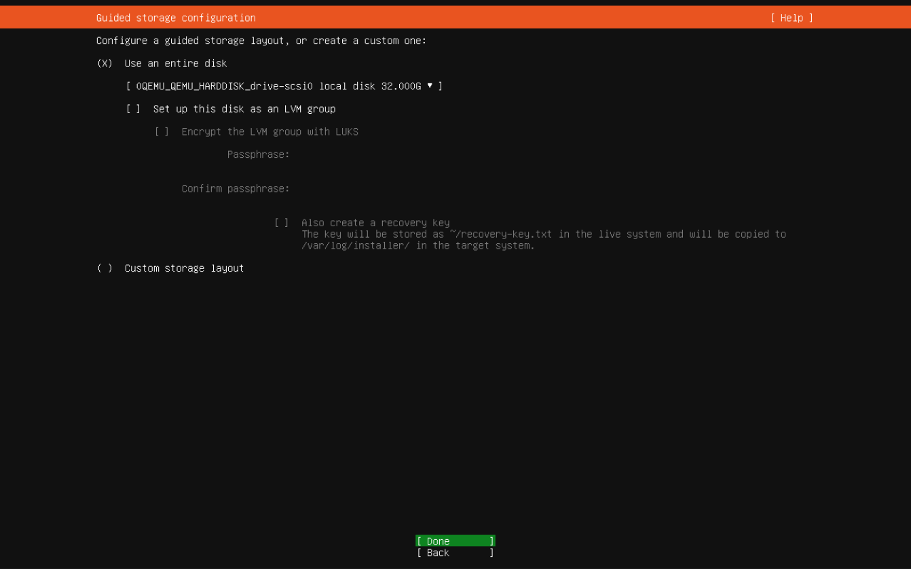

### OpenSSH Server

I installed OpenSSH Server during the installation so I could remotely access Ubuntu from my Windows PC without needing to use the Proxmox console.

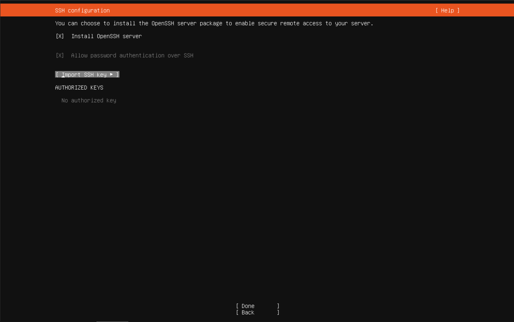

### Installation Complete

After completing the installation, I restarted the virtual machine and booted into Ubuntu Server.

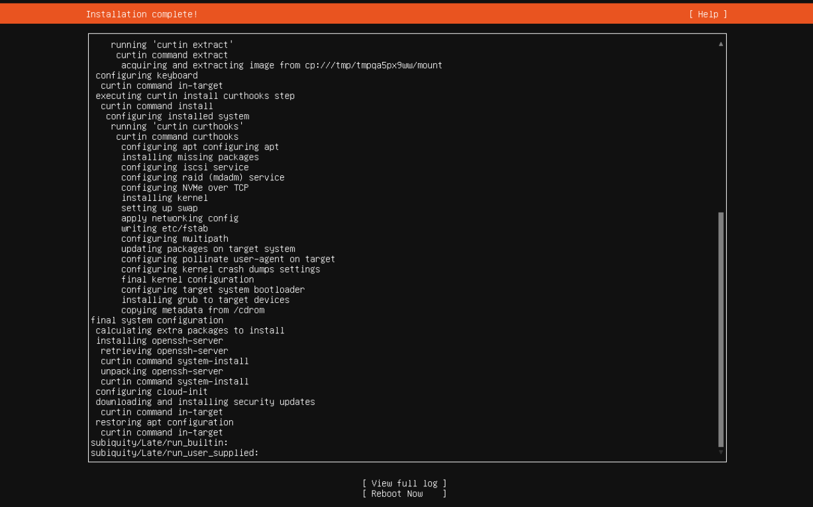

## 4. First Login and Network Verification

After logging into Ubuntu Server, I checked the network configuration to identify the IP address assigned to the virtual machine.

I used the following command:

```bash
ip addr
```

| Configuration | Value |
|---|---|
| IP Address | 192.168.0.231 |
| Network Bridge | vmbr0 |
| IP Assignment | DHCP |

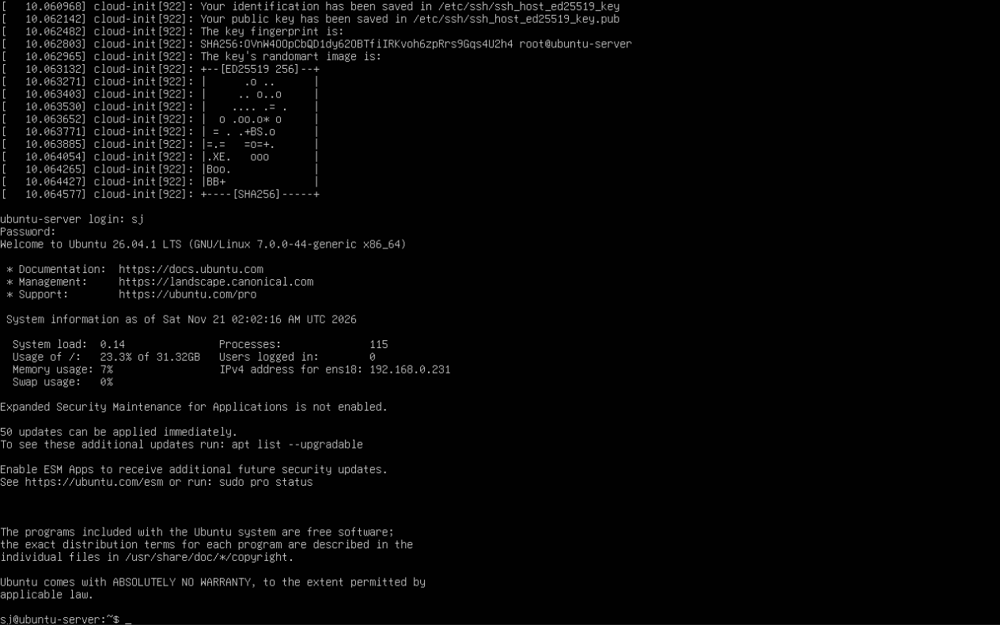

## 5. Remote Access Using SSH

With OpenSSH installed, I connected to Ubuntu Server from my Windows PC using the terminal.

The following is an example of the command used to connect:

```bash
ssh username@192.168.0.231
```

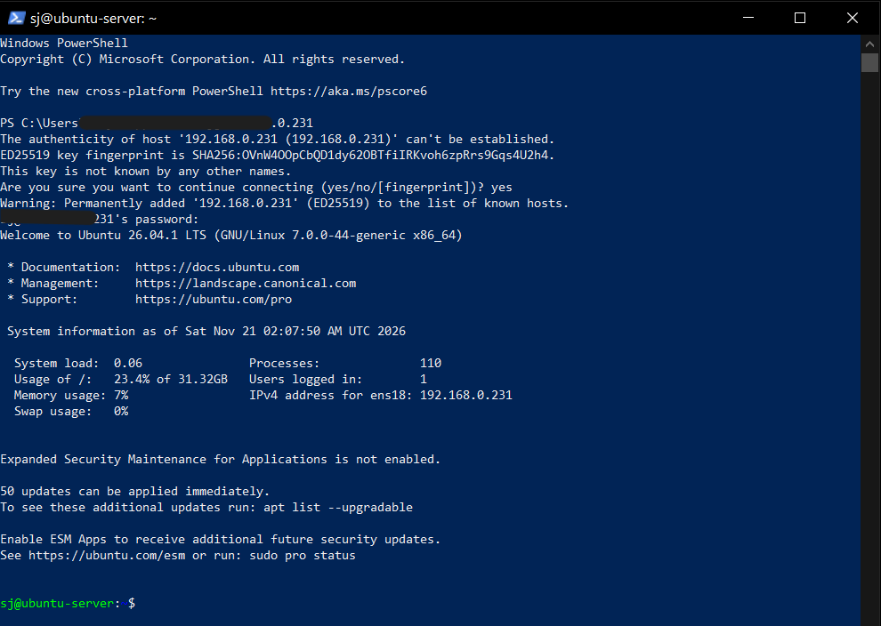

This allowed me to access and manage Ubuntu Server remotely without opening the Proxmox virtual machine console.

## 6. Updating Ubuntu Server

After establishing an SSH connection, I refreshed the package lists and installed the available system updates.

### Refreshing Package Lists

```bash
sudo apt update
```

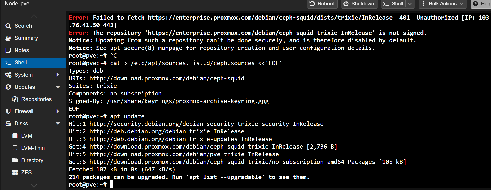

### Installing System Updates

```bash
sudo apt upgrade
```

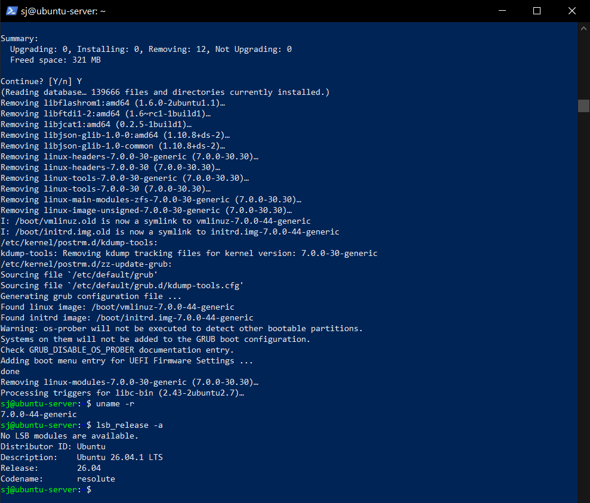

Keeping the operating system updated helps maintain security and system stability.

## 7. Final Result

I successfully deployed Ubuntu Server on Proxmox, verified its network configuration, established remote access through SSH and completed the initial system updates.

The virtual machine is now ready for further Linux administration and networking projects.

## Completion Checklist

- [x] Uploaded Ubuntu Server ISO
- [x] Created a virtual machine in Proxmox
- [x] Allocated CPU, RAM and storage
- [x] Configured virtual networking
- [x] Installed Ubuntu Server
- [x] Installed OpenSSH Server
- [x] Verified the assigned IP address
- [x] Connected remotely from Windows using SSH
- [x] Completed system updates

## Skills Practised

- Virtual machine deployment
- Virtual hardware allocation
- Linux installation and configuration
- Virtual networking
- DHCP and IP addressing
- SSH remote access
- Linux command-line usage
- APT package management
- Technical documentation

## Project Outcome

This project allowed me to build on my previous experience with VirtualBox by deploying and managing a Linux virtual machine on a dedicated Proxmox server.

I now have a working Ubuntu Server environment that I can use to continue developing my Linux administration, networking and IT troubleshooting skills.

---

[Return to Project Overview](../README.md)
