# 04 – Linux User & Group Administration

## Overview

After deploying Ubuntu Server on Proxmox, I wanted to move beyond the initial server setup and start practising everyday IT administration tasks.

I created a simulated business environment called Greenworks to practise managing employee accounts, groups, shared directories, file permissions and access restrictions.

The aim was to work through situations that an IT support technician or system administrator might encounter in a workplace.

## Lab Architecture

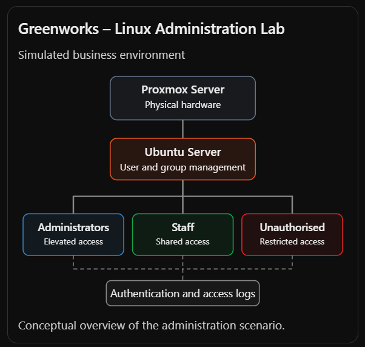

## Project Objectives

- Manage Linux users and groups.
- Configure shared company directories.
- Manage file permissions and ownership.
- Simulate employee onboarding and offboarding.
- Apply the principle of least privilege.
- Test authorised and unauthorised access.
- Investigate SSH authentication logs.
- Troubleshoot account and permission issues.

---

## 1. Linux Administration Preparation

Before setting up Greenworks, I worked through several Linux administration exercises to build on my existing knowledge and become more comfortable using the command line.

### Baseline Snapshot

I created a baseline snapshot through the Proxmox web interface before making further changes to Ubuntu Server.

| Configuration | Value |
|---|---|
| Virtual Machine | VM 100 |
| Snapshot Name | `Clean-install-updated` |
| Operating System | Ubuntu Server |
| Purpose | Recovery point before administration testing |

This gave me a recovery point in case something went wrong during testing.


### Filesystem Navigation

I practised navigating the Linux filesystem and viewing directory contents.

**Commands used:**

```bash
pwd
ls
ls -la
cd /
cd ~
```

| Directory | Purpose |
|---|---|
| `/` | Root of the Linux filesystem |
| `/home/sj` | My user's home directory |
| `/etc` | System configuration files |
| `/var` | Logs and variable application data |
| `/srv` | Data provided by system services |


### File and Directory Management

I created a practice directory called `linux-lab` to work with files and directories.

**Commands used:**

```bash
mkdir linux-lab
cd linux-lab
touch notes.txt
echo "My first Linux lab file" > notes.txt
cat notes.txt
cp notes.txt notes-copy.txt
mv notes-copy.txt backup-notes.txt
mkdir backups
mv backup-notes.txt backups/
ls -R
```

**Final directory structure:**

```text
~/linux-lab/
├── notes.txt
└── backups/
    └── backup-notes.txt
```


### Permissions and Ownership

I used the `notes.txt` file to practise changing and inspecting Linux permissions.

**Commands used:**

```bash
cd ~/linux-lab
ls -l
chmod +x notes.txt
ls -l
chmod 644 notes.txt
ls -l notes.txt
whoami
groups
```

The final permissions were:

```text
-rw-r--r--
```

| User Type | Permission |
|---|---|
| Owner | Read and write |
| Group | Read only |
| Others | Read only |


### Users and Groups

I used a test account called `testuser` and created a group called `labusers` before applying group-based permissions to Greenworks.

**Commands practised:**

```bash
groups testuser
sudo groupadd labusers
```

The command for adding the test account to the group is:

```bash
sudo usermod -aG labusers testuser
```

This can be verified using:

```bash
groups testuser
```


---

## 2. Greenworks Business Scenario

Greenworks is a simulated business environment created to practise managing employee access to company resources.

### User Accounts

| Username | Role |
|---|---|
| `sj` | Linux system administrator |
| `gwadmin` | Greenworks business administrator |
| `gwstaff` | Standard employee |
| `student1` | Unauthorised test user |

### Security Groups

| Group Name | Purpose |
|---|---|
| `greenworks` | Access to shared staff resources |
| `greenworks-admin` | Access to restricted administrative resources |

### Company Directory Structure

```text
/srv/greenworks/
├── shared/
│   ├── job-schedule.txt
│   ├── quote-template.txt
│   ├── staff-test.txt
│   └── weekly-jobs.txt
│
└── admin/
    └── payroll-test.txt
```

### Access Control

| Resource | gwadmin | gwstaff | student1 |
|---|---|---|---|
| Staff shared directory | Allowed | Allowed | Denied |
| Administrator directory | Allowed | Denied | Denied (intended) |
| System administration (sudo) | Not assigned | Denied | Not assigned |

The aim was to manage access through group memberships rather than giving every employee administrative privileges.

---

## 3. Staff Shared Folder

I created a shared directory for Greenworks employees so authorised users could access company files without requiring sudo privileges.

### Configuration

| Configuration | Value |
|---|---|
| Directory | `/srv/greenworks/shared` |
| Security Group | `greenworks` |
| Owner | `root` |
| Group Owner | `greenworks` |
| Initial Permissions | `770` |
| Test Account | `gwadmin` |
| Test File | `job-schedule.txt` |

### Creating the Group and User

```bash
sudo groupadd greenworks
sudo adduser gwadmin
sudo usermod -aG greenworks gwadmin
groups gwadmin
```

### Creating the Shared Directory

```bash
sudo mkdir -p /srv/greenworks/shared
sudo chown root:greenworks /srv/greenworks/shared
sudo chmod 770 /srv/greenworks/shared
ls -ld /srv/greenworks/shared
```

**Initial directory permissions:**

```text
drwxrwx---
```

| User Type | Access |
|---|---|
| Owner | Read, write and execute |
| Group | Read, write and execute |
| Others | No access |

### Testing Access

```bash
su - gwadmin
groups
cd /srv/greenworks/shared
touch job-schedule.txt
ls -l
```

**Result:** The `gwadmin` account successfully accessed the shared directory and created a file.

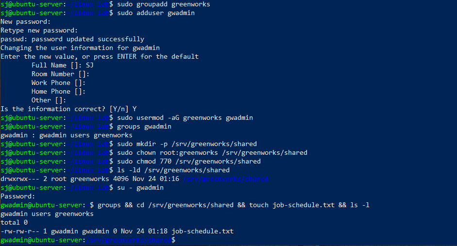

---

## 4. Unauthorised Access Test

I created a separate user called `student1` without adding the account to the `greenworks` group.

The purpose was to check whether an unauthorised user could access the company directory.

**Commands used:**

```bash
sudo adduser student1
groups student1
su - student1
cd /srv/greenworks/shared
```

**Result:**

```text
Permission denied
```

The account was unable to access the shared directory because it was not a member of the required group.

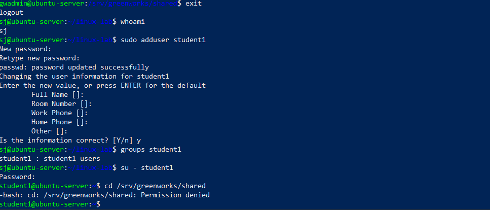

---

## 5. New Employee Onboarding

I simulated a new employee joining Greenworks by creating an account called `gwstaff` and assigning the appropriate group membership.

### Employee Configuration

| Configuration | Value |
|---|---|
| Username | `gwstaff` |
| Role | Standard employee |
| Assigned Group | `greenworks` |
| Required Directory | `/srv/greenworks/shared` |
| Test File | `staff-test.txt` |

### Creating the Employee Account

```bash
sudo adduser gwstaff
groups gwstaff
sudo usermod -aG greenworks gwstaff
groups gwstaff
```

### Testing Employee Access

```bash
su - gwstaff
groups
cd /srv/greenworks/shared
pwd
touch staff-test.txt
ls -l
```

**Result:** The new employee successfully accessed the shared directory and created a test file.

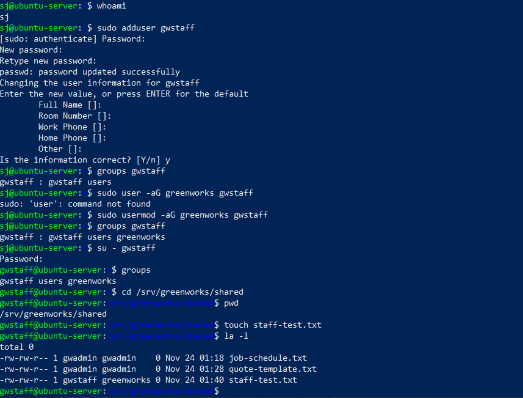

This exercise reflects a common IT support responsibility when setting up access for new employees.

---

## 6. Principle of Least Privilege

I tested whether the `gwstaff` account could access company resources without having unnecessary system administration privileges.

### Testing Staff Permissions

```bash
whoami
groups
cd /srv/greenworks/shared
touch staff-test.txt
```

### Testing Administrative Privileges

```bash
sudo apt update
```

**Result:**

```text
sudo: I'm sorry gwstaff. I'm afraid I can't do that
```

| Test | Result |
|---|---|
| Access shared directory | Successful |
| Create staff file | Successful |
| Execute administrative command | Denied |

The employee could perform their intended duties without being given unnecessary administrative privileges.

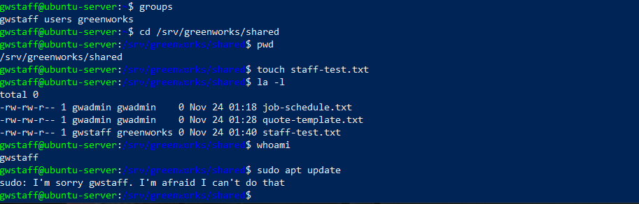

---

## 7. Employee Offboarding

I simulated an employee leaving Greenworks by removing their membership from the `greenworks` group.

The user account remained on the system, but access to company resources was removed.

### Removing Group Membership

```bash
exit
groups gwstaff
sudo gpasswd -d gwstaff greenworks
groups gwstaff
```

### Testing Access After Removal

```bash
su - gwstaff
cd /srv/greenworks/shared
```

**Result:**

```text
Permission denied
```

| Configuration | Before | After |
|---|---|---|
| User Account | Active | Active |
| Greenworks Group | Member | Removed |
| Shared Directory Access | Allowed | Denied |

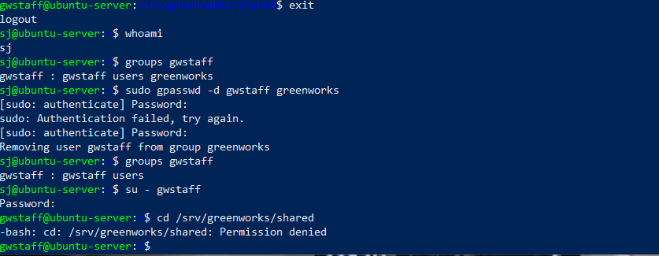

This demonstrated how group memberships can be used to revoke access without deleting a user account.

---

## 8. Staff Account Lockout

As part of the offboarding scenario, I also practised locking the employee's password.

### Checking Account Status

```bash
sudo passwd -S gwstaff
```

### Locking the Password

```bash
sudo passwd -l gwstaff
sudo passwd -S gwstaff
```

### Testing Authentication

```bash
su - gwstaff
```

**Result:**

```text
su: Authentication failure
```

### Password Status

| Status | Meaning |
|---|---|
| `P` | Usable password |
| `L` | Locked password |
| `NP` | No password |

The password status changed from `P` to `L`, and password-based authentication failed during testing.

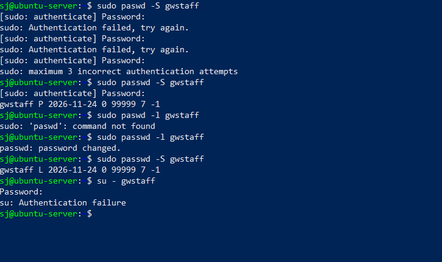

Locking a password does not necessarily disable other authentication methods, such as SSH keys, or terminate existing sessions.

---

## 9. Account Restoration

I simulated a situation where the employee's account needed to be restored.

### Unlocking the Password

```bash
sudo passwd -u gwstaff
sudo passwd -S gwstaff
```

### Testing Authentication and Access

```bash
su - gwstaff
whoami
cd /srv/greenworks/shared
```

**Result:**

```text
Permission denied
```

The employee was able to authenticate again but still could not access the shared directory.

This was because the `greenworks` group membership had previously been removed.

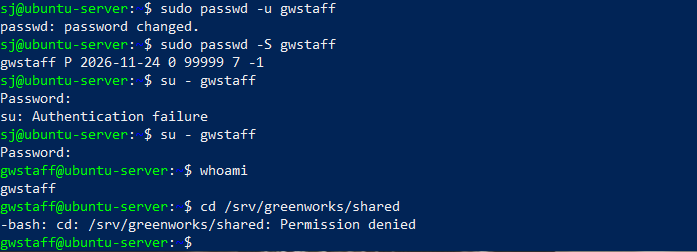

### Restoring Group Membership

```bash
exit
sudo usermod -aG greenworks gwstaff
groups gwstaff
```

### Verifying the Account

```bash
su - gwstaff
groups
pwd
touch restored-access-test.txt
ls -l restored-access-test.txt
```

**Result:** The employee's group membership was restored, and the account could create files in its home directory.

The test file was created at:

```text
/home/gwstaff/restored-access-test.txt
```

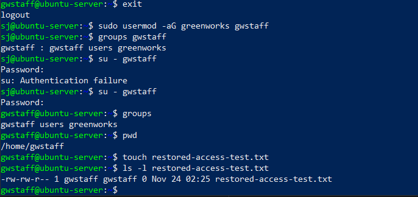

Successful access to the shared company directory was later confirmed during the shared file collaboration exercise.

### Authentication vs Authorisation

| Concept | Meaning |
|---|---|
| Authentication | Verifying the user's identity |
| Authorisation | Determining which resources the user can access |

This exercise demonstrated that successfully logging into an account does not automatically grant access to company resources.

---

## 10. Administrator Folder Access Control

I created a separate directory for restricted administrative resources, such as payroll files.

Standard employees should not have access to this directory.

### Configuration

| Configuration | Value |
|---|---|
| Directory | `/srv/greenworks/admin` |
| Security Group | `greenworks-admin` |
| Owner | `root` |
| Group Owner | `greenworks-admin` |
| Permissions | `2770` |
| Authorised Account | `gwadmin` |
| Test File | `payroll-test.txt` |

### Creating the Administrator Group

```bash
sudo groupadd greenworks-admin
sudo usermod -aG greenworks-admin gwadmin
groups gwadmin
```

### Creating the Restricted Directory

```bash
sudo mkdir -p /srv/greenworks/admin
sudo chown root:greenworks-admin /srv/greenworks/admin
sudo chmod 2770 /srv/greenworks/admin
ls -ld /srv/greenworks/admin
```

**Directory permissions:**

```text
drwxrws---
```

The additional `2` in `2770` enables the setgid permission.

This allows new files created inside the directory to inherit the directory's group ownership.

### Testing Administrator Access

```bash
su - gwadmin
cd /srv/greenworks/admin
touch payroll-test.txt
ls -l
```

### Testing Standard Employee Access

```bash
exit
su - gwstaff
cd /srv/greenworks/admin
```

**Result:**

| Account | Administrator Directory |
|---|---|
| `gwadmin` | Access granted |
| `gwstaff` | Permission denied |

The `payroll-test.txt` file inherited the `greenworks-admin` group ownership.

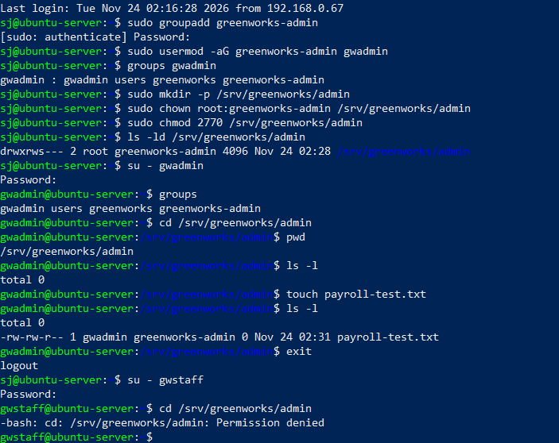

---

## 11. Shared File Collaboration

I tested whether multiple authorised employees could work on the same file within the shared company directory.

### Test Configuration

| Configuration | Value |
|---|---|
| Directory | `/srv/greenworks/shared` |
| Shared File | `weekly-jobs.txt` |
| File Owner | `gwadmin` |
| File Group | `greenworks` |
| File Permissions | `664` |
| Collaborating User | `gwstaff` |

### Creating the Shared File

Using the `gwadmin` account:

```bash
su - gwadmin
cd /srv/greenworks/shared
echo "Greenworks weekly job schedule" > weekly-jobs.txt
ls -l weekly-jobs.txt
```

### Editing the File as an Employee

Using the `gwstaff` account:

```bash
exit
su - gwstaff
cd /srv/greenworks/shared
echo "Monday: Garden maintenance job" >> weekly-jobs.txt
cat weekly-jobs.txt
```

### Final File Contents

```text
Greenworks weekly job schedule
Monday: Garden maintenance job
```

**Result:** Both authorised users successfully collaborated on the same file.

This also confirmed that the restored `gwstaff` account could access the shared directory again.

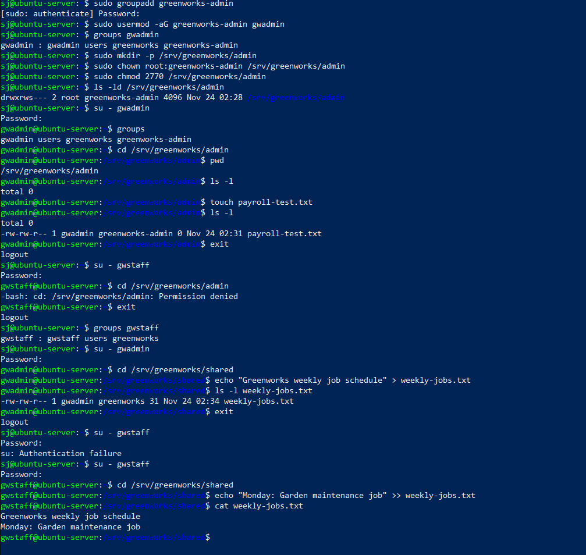

---

## 12. SSH Authentication Monitoring

I checked the SSH service and reviewed recent authentication activity on Ubuntu Server.

### Checking the SSH Service

```bash
systemctl status ssh
```

**Service status:**

```text
Active: active (running)
```

The output also displayed recent authentication activity, including successful logins, invalid usernames and failed password attempts.

| Log Entry | Meaning |
|---|---|
| `Accepted password` | Successful password authentication |
| `Failed password` | Unsuccessful password authentication |
| `Invalid user` | Username does not exist on the server |
| `Authentication failure` | Authentication was unsuccessful |
| `Session opened` | A user session was established |

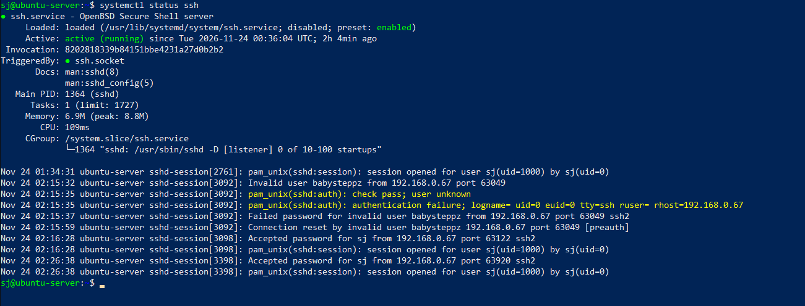

---

## 13. SSH Log Troubleshooting

I used `journalctl` and `grep` to investigate SSH authentication activity.

Rather than searching through all system logs manually, I filtered the output to display relevant authentication events.

### Viewing Recent SSH Logs

```bash
sudo journalctl -u ssh --since "30 minutes ago"
```

### Filtering Failed Login Attempts

```bash
sudo journalctl -u ssh | grep "Failed"
```

### Filtering Successful Login Attempts

```bash
sudo journalctl -u ssh | grep "Accepted"
```

### Findings

The logs showed failed SSH login attempts involving an invalid username, followed by successful authentication using the correct Ubuntu account.

This demonstrated how system logs can help identify whether an authentication issue is related to an incorrect username, failed password authentication or another connection issue.

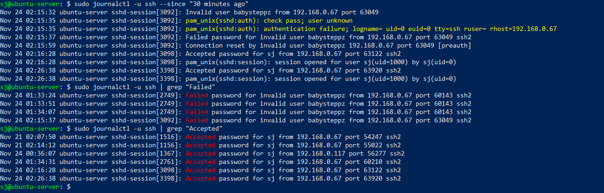

---

## 14. Access Management Test Results

| Test Scenario | Expected Result | Actual Result |
|---|---|---|
| Authorised staff access | Access granted | Passed |
| Unauthorised user access | Permission denied | Passed |
| New employee onboarding | Shared access granted | Passed |
| Least privilege | Administrative command denied | Passed |
| Employee offboarding | Shared access removed | Passed |
| Password lockout | Password authentication denied | Passed |
| Password restoration | Authentication restored | Passed |
| Access before group restoration | Permission denied | Passed |
| Staff group restoration | Group membership restored | Passed |
| Administrator directory access | Restricted to authorised users | Passed for tested accounts |
| Shared file collaboration | Both users can edit shared file | Passed |
| SSH log monitoring | Authentication events identified | Passed |

---

## 15. Key Linux Commands

| Command | Purpose |
|---|---|
| `adduser` | Create a user account |
| `groupadd` | Create a security group |
| `usermod -aG` | Add a user to a supplementary group |
| `gpasswd -d` | Remove a user from a group |
| `groups` | Display group memberships |
| `whoami` | Display the current user |
| `su -` | Switch to another user |
| `sudo` | Execute commands with elevated privileges |
| `chmod` | Change file and directory permissions |
| `chown` | Change file and directory ownership |
| `passwd -l` | Lock a user's password |
| `passwd -u` | Unlock a user's password |
| `passwd -S` | Check password status |
| `ls -l` | Display file permissions and ownership |
| `ls -ld` | Display directory permissions and ownership |
| `mkdir -p` | Create directories and parent directories |
| `touch` | Create an empty file |
| `echo` | Display or write text |
| `cat` | Display file contents |
| `systemctl status` | Check system service status |
| `journalctl` | Review system logs |
| `grep` | Filter text and log output |

### Permission Values Used

| Value | Purpose |
|---|---|
| `644` | Owner can read and write; group and others can read |
| `664` | Owner and group can read and write; others can read |
| `770` | Full access for owner and group; no access for others |
| `2770` | Same as 770 with setgid group inheritance |

---

## Technical Concepts Practised

| Concept | Description |
|---|---|
| Authentication | Verifying a user's identity |
| Authorisation | Determining which resources a user can access |
| Least Privilege | Providing only the permissions required |
| Group-Based Access | Managing access through group memberships |
| Privilege Separation | Separating administrative and standard user access |
| Account Lifecycle | Managing employee onboarding and offboarding |
| Access Revocation | Removing permissions that are no longer required |
| Setgid | Inheriting directory group ownership |
| Log Analysis | Investigating authentication and system events |
| VM Snapshots | Creating recovery points before making changes |

## Skills Developed

- Linux user and group administration
- File and directory management
- Linux permissions and ownership
- Employee onboarding and offboarding
- Account restoration
- Group-based access control
- Shared directory configuration
- Principle of least privilege
- SSH authentication monitoring
- System log analysis
- Technical troubleshooting
- Infrastructure documentation

## Project Outcome

This project allowed me to apply Linux administration concepts to a simulated workplace environment rather than just practising individual commands.

One of the most useful exercises was restoring an employee's account and discovering that authentication and resource access needed to be managed separately.

Working through these scenarios gave me practical experience with tasks that are relevant to IT support and system administration, including employee onboarding, offboarding, access management and authentication troubleshooting.

I plan to continue expanding the Greenworks environment with additional networking, server administration and security projects.

---

[Return to Project Overview](../README.md)
