# 05 – Linux Networking & Troubleshooting

## Overview

After completing the user and group administration side of my Greenworks home lab, I wanted to spend more time working on networking and troubleshooting.

I already had an understanding of networking fundamentals through my IT studies and previous experience with virtual machines. However, I wanted to put that knowledge into practice using my dedicated Proxmox server, Ubuntu Server and Windows PC.

Rather than just checking that everything worked, I deliberately introduced network and service issues to practise identifying problems, finding their causes and restoring connectivity.

## Network Architecture

The diagram below shows how my physical server, Ubuntu virtual machine, Windows PC and router are connected within my home network.

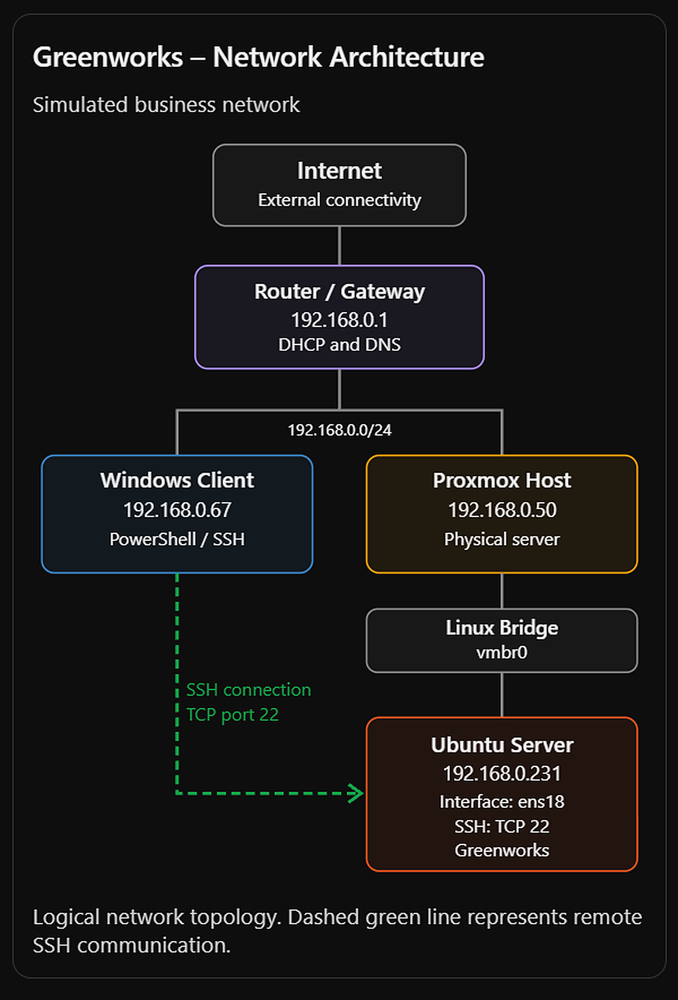

> Greenworks is a simulated business environment running within my private home lab. All IP addresses shown are private network addresses.

### Network Configuration

| Component | Configuration |
|---|---|
| Network | `192.168.0.0/24` |
| Subnet Mask | `255.255.255.0` |
| Default Gateway | `192.168.0.1` |
| DNS Server | `192.168.0.1` |
| Windows Client | `192.168.0.67` |
| Proxmox Host | `192.168.0.50` |
| Ubuntu Server | `192.168.0.231` |
| Ubuntu Network Interface | `ens18` |
| Proxmox Network Bridge | `vmbr0` |
| SSH Port | `TCP 22` |

## Project Objectives

- Verify network configuration and connectivity.
- Investigate DNS configuration and resolution.
- Simulate and troubleshoot DNS failures.
- Check listening ports and network services.
- Troubleshoot SSH connection failures.
- Investigate networking issues from Windows and Linux.
- Practise following a structured troubleshooting process.

---

## 1. Network Configuration Baseline

Before introducing any problems, I wanted to establish that my Ubuntu Server had a working network connection.

This gave me a baseline to compare against when troubleshooting later on.

### Checking the Network Configuration

```bash
ip -br addr
```

This displayed the network interfaces and their assigned IP addresses.

| Configuration | Value |
|---|---|
| Network Interface | `ens18` |
| IPv4 Address | `192.168.0.231/24` |
| Default Gateway | `192.168.0.1` |

### Testing Local Connectivity

```bash
ping -c 4 192.168.0.1
```

I tested whether Ubuntu could communicate with my router.

### Testing Internet Connectivity

```bash
ping -c 4 1.1.1.1
```

I used an external IP address to test internet connectivity without relying on DNS.

### Testing Domain Name Connectivity

```bash
ping -c 4 google.com
```

This allowed me to check whether Ubuntu could resolve a domain name and communicate with the destination.

### Results

| Test | Result |
|---|---|
| Local gateway connectivity | Successful |
| External IP connectivity | Successful |
| Domain name resolution and connectivity | Successful |
| Packet loss | 0% |

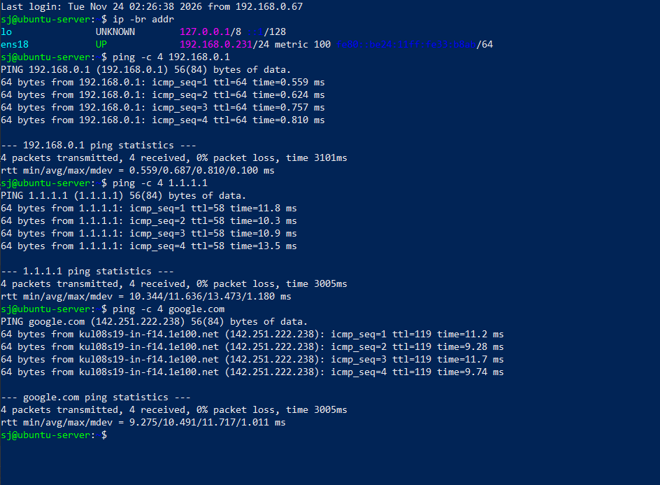

With everything working, I had a reference point before deliberately introducing network problems.

---

## 2. DNS Configuration and Resolution

I checked the DNS configuration on Ubuntu Server to see which DNS server it was using and whether domain names were resolving correctly.

### Commands Used

```bash
resolvectl status
resolvectl dns
resolvectl query google.com
```

### DNS Configuration

| Configuration | Value |
|---|---|
| Network Interface | `ens18` |
| DNS Server | `192.168.0.1` |
| Test Domain | `google.com` |

**Result:** Ubuntu was using my router as its DNS server and was successfully resolving domain names.

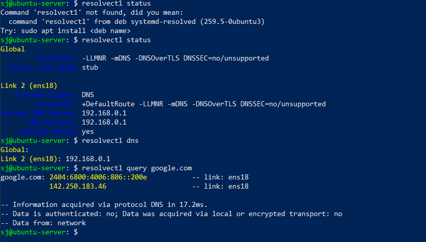

---

## 3. Simulating a DNS Failure

For this exercise, I deliberately configured Ubuntu to use an incorrect DNS server.

I wanted to simulate a situation where a device still had internet connectivity but could no longer resolve domain names.

### Simulated Fault

| Configuration | Value |
|---|---|
| Correct DNS Server | `192.168.0.1` |
| Incorrect DNS Server | `192.0.2.1` |
| Affected Interface | `ens18` |

### Troubleshooting

I started by testing connectivity to an external IP address.

```bash
ping -c 4 1.1.1.1
```

The ping was successful, which indicated that the server still had external IP connectivity.

I then tested connectivity using a domain name.

```bash
ping -c 4 google.com
```

### Error Encountered

```text
Temporary failure in name resolution
```

Since the external IP address was reachable but the domain name was not resolving, I suspected that the issue was related to DNS rather than a complete loss of network connectivity.

I checked the DNS configuration using:

```bash
resolvectl query google.com
resolvectl dns
```

### Identifying the Cause

The network interface was using the incorrect DNS server:

```text
192.0.2.1
```

### Resolving the Issue

I reverted the temporary DNS configuration and cleared the DNS cache.

```bash
sudo resolvectl revert ens18
sudo resolvectl flush-caches
```

I then repeated the original tests.

```bash
resolvectl query google.com
ping -c 4 google.com
```

### Results

| Test | During Failure | After Recovery |
|---|---|---|
| External IP connectivity | Successful | Successful |
| DNS resolution | Failed | Successful |
| Domain name connectivity | Failed | Successful |

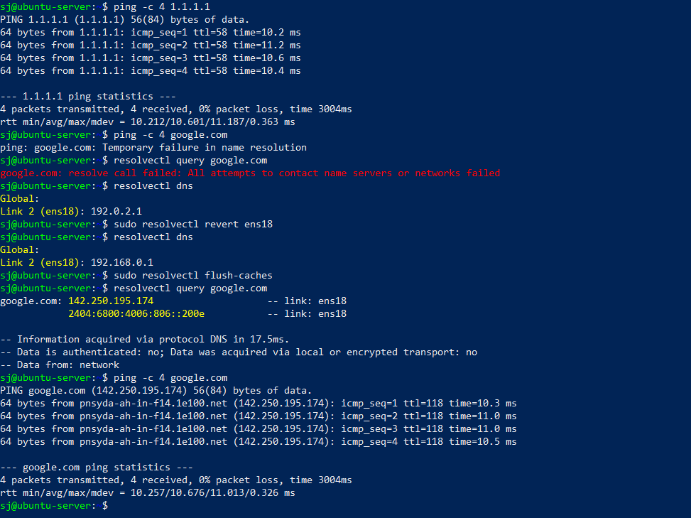

This was a useful exercise because it allowed me to practise narrowing down a network problem instead of immediately assuming that the entire internet connection was down.

---

## 4. SSH Port Verification

Since I was managing Ubuntu Server remotely through SSH, I wanted to check which ports were listening and confirm that the SSH service was running.

### Checking Listening Ports

```bash
sudo ss -tlnp
```

To narrow down the output to SSH:

```bash
sudo ss -tlnp | grep ":22"
```

### Checking the SSH Service

```bash
systemctl status ssh
```

### SSH Configuration

| Configuration | Value |
|---|---|
| Service | OpenSSH |
| Protocol | TCP |
| Port | `22` |
| Server IP | `192.168.0.231` |

**Result:** SSH was running and listening on TCP port 22.

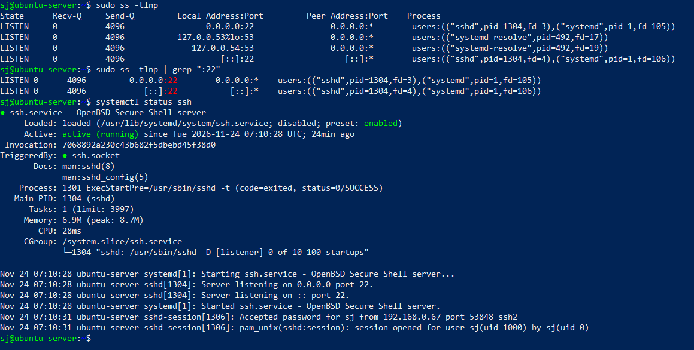

---

## 5. Simulating an SSH Service Failure

I deliberately stopped the SSH service to simulate a situation where a server was online but could not be accessed remotely through SSH.

I carried out the service troubleshooting through the Proxmox console so I could still manage the virtual machine without relying on SSH.

### Stopping the SSH Service

```bash
sudo systemctl stop ssh
```

I then checked whether port 22 was still listening.

```bash
sudo ss -tlnp | grep ":22"
```

### Unexpected Behaviour

When stopping the SSH service, I received the following message:

```text
Stopping 'ssh.service', but its triggering units are still active:
ssh.socket
```

Initially, I expected stopping the SSH service to be enough to close port 22.

However, the SSH socket was still active.

### Investigating the SSH Socket

```bash
systemctl status ssh.socket
```

I found that Ubuntu was using systemd socket activation for SSH.

| Component | Purpose |
|---|---|
| `ssh.service` | Runs the OpenSSH server |
| `ssh.socket` | Listens for incoming connections and can activate the SSH service |

### Stopping Both Components

```bash
sudo systemctl stop ssh.socket
sudo systemctl stop ssh.service
```

I checked the listening port again.

```bash
sudo ss -tlnp | grep ":22"
```

This time, there was no matching output, indicating that nothing was listening on TCP port 22.

### Restoring SSH

```bash
sudo systemctl start ssh.socket
sudo systemctl start ssh.service
```

### Verifying Recovery

```bash
sudo ss -tlnp | grep ":22"
systemctl status ssh.socket
```

**Result:** TCP port 22 was listening again, and SSH was restored.

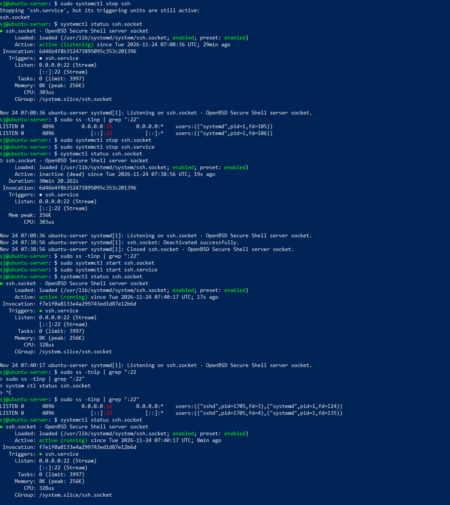

This was one of the more interesting parts of the lab because I encountered something I did not initially expect.

It gave me a better understanding of how systemd services and sockets work together, and why checking the actual listening port is important when troubleshooting a service.

---

## 6. Remote SSH Port Testing from Windows

After checking SSH locally on Ubuntu, I wanted to verify that the service was also reachable from my Windows PC.

I used Windows PowerShell to test the connection.

### Testing TCP Port 22

```powershell
Test-NetConnection 192.168.0.231 -Port 22
```

### Result

```text
TcpTestSucceeded : True
```

This confirmed that my Windows PC could establish a TCP connection to port 22 on Ubuntu Server.

### Testing SSH Authentication

```powershell
ssh sj@192.168.0.231
```

I successfully connected to Ubuntu Server from Windows.

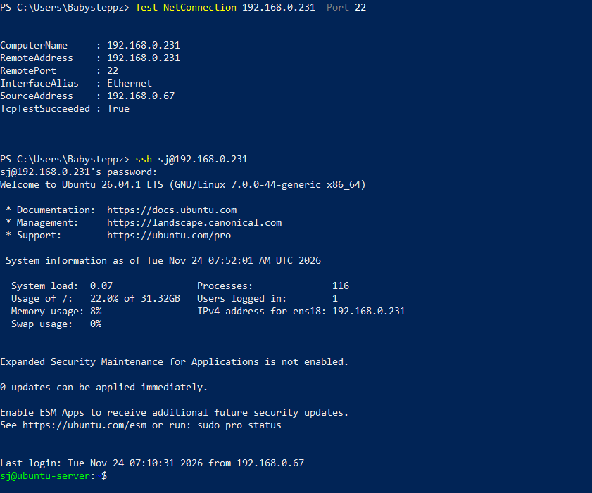

This allowed me to verify both network-level connectivity and remote authentication.

---

## 7. Remote SSH Failure and Recovery

I repeated the SSH failure exercise, this time investigating the issue from the Windows client.

The aim was to approach the problem from the perspective of a user who could no longer connect to a server.

### Testing Server Connectivity

```powershell
ping 192.168.0.231
```

The server was still responding to ping.

### Testing SSH Port Availability

```powershell
Test-NetConnection 192.168.0.231 -Port 22
```

### Result During Failure

```text
TcpTestSucceeded : False
```

Although Ubuntu was responding to ping, the SSH port was unavailable.

This helped narrow down the issue to the SSH service or its listening port rather than a complete network outage.

### Restoring SSH on Ubuntu

```bash
sudo systemctl start ssh.socket
sudo systemctl start ssh.service
```

### Retesting from Windows

```powershell
Test-NetConnection 192.168.0.231 -Port 22
ssh sj@192.168.0.231
```

### Result After Recovery

```text
TcpTestSucceeded : True
```

| Test | During Failure | After Recovery |
|---|---|---|
| Server responds to ping | Successful | Not retested |
| TCP port 22 | Failed | Successful |
| SSH connection | Unavailable | Successful |

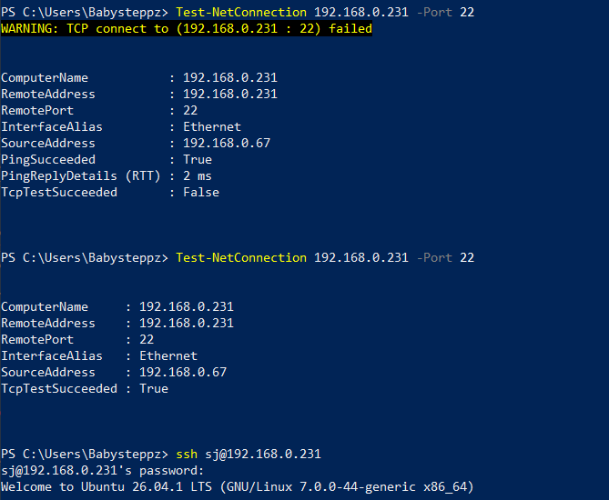

This exercise reinforced that a successful ping does not necessarily mean every service on a server is working.

---

## 8. Windows Client Network Troubleshooting

Since IT support often involves troubleshooting issues from the user's computer, I also worked through some network checks using Windows PowerShell.

### Checking IP Configuration

```powershell
ipconfig
```

### Windows Network Configuration

| Configuration | Value |
|---|---|
| IPv4 Address | `192.168.0.67` |
| Subnet Mask | `255.255.255.0` |
| Default Gateway | `192.168.0.1` |

### Testing Gateway Connectivity

```powershell
ping 192.168.0.1
```

### Testing DNS Resolution

```powershell
nslookup google.com
```

### Testing Server Port Availability

```powershell
Test-NetConnection 192.168.0.231 -Port 22
```

### Results

| Test | Result |
|---|---|
| IP configuration | Verified |
| Gateway connectivity | Successful |
| DNS resolution | Successful |
| SSH port connectivity | Successful |

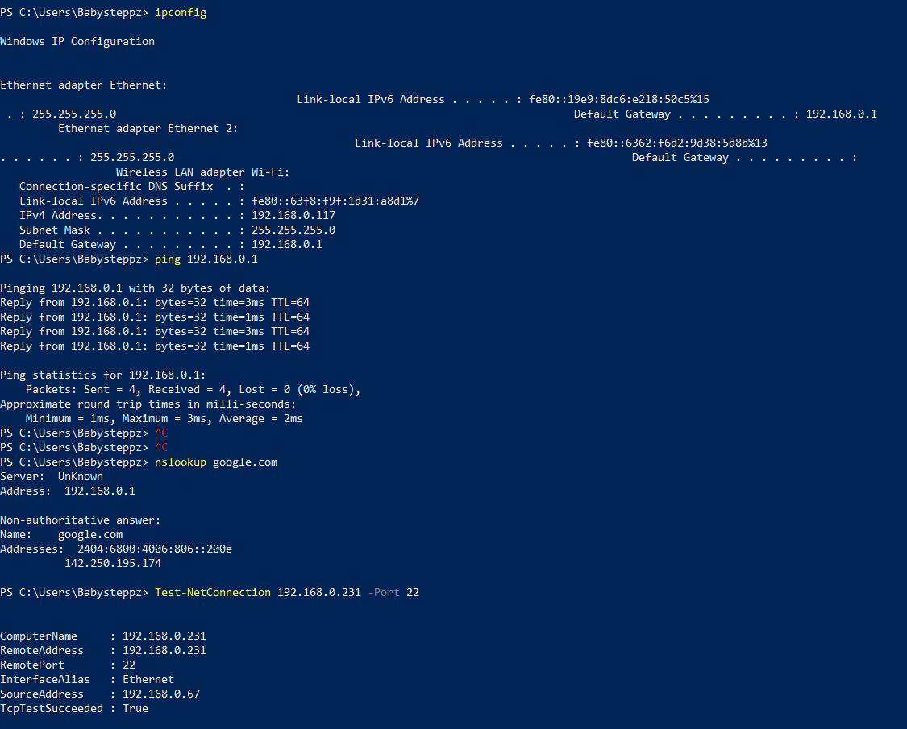

Having previously used Windows for many years, this was a good opportunity to apply familiar Windows networking tools alongside the Linux commands I had been practising.

---

## 9. Windows DNS Troubleshooting

I wanted to compare DNS troubleshooting on Windows with the DNS failure exercise I had completed on Ubuntu.

Instead of permanently changing my Windows network settings, I directed a DNS query to an incorrect DNS server.

### Testing an Incorrect DNS Server

```powershell
nslookup google.com 192.0.2.1
```

### Error Encountered

```text
DNS request timed out.
```

I then repeated the query using the default DNS configuration.

```powershell
nslookup google.com
```

### Results

| DNS Server | Result |
|---|---|
| `192.0.2.1` | Request timed out |
| Default DNS server | Successful resolution |

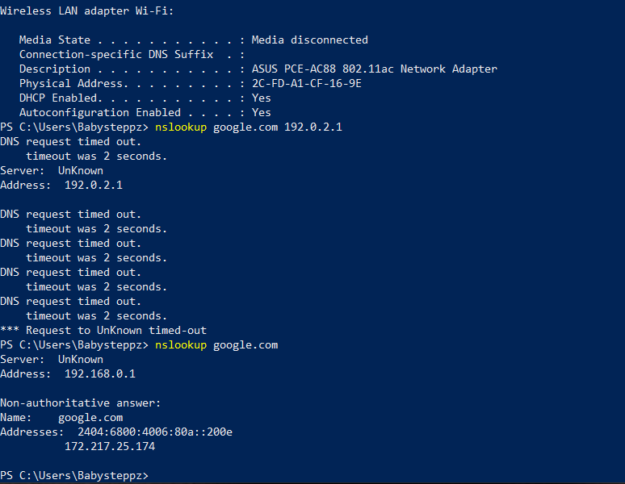

This allowed me to compare the behaviour of a working DNS server with an unavailable one without changing the permanent network configuration on my Windows PC.

---

## 10. Network Path Analysis

For the final exercise, I used traceroute from Windows to investigate the network path between my computer and an external destination.

### Command Used

```powershell
tracert 1.1.1.1
```

### Results

| Configuration | Value |
|---|---|
| Source | Windows Client |
| Destination | `1.1.1.1` |
| First Hop | Local Router |
| Total Hops | 7 |
| Destination Reached | Yes |

During the test, one of the intermediate hops did not respond.

However, the trace continued and successfully reached the destination.

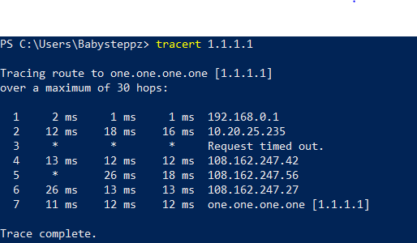

This reinforced that a timeout at an individual hop does not necessarily indicate a network failure, as some devices may not respond to traceroute requests while still forwarding traffic.

---

## 11. Troubleshooting Methodology

Throughout this lab, I tried to follow a structured troubleshooting process rather than changing multiple settings at once.

### My Troubleshooting Process

1. Identify the problem.
2. Check the current network configuration.
3. Test local network connectivity.
4. Test external IP connectivity.
5. Check DNS resolution.
6. Check the affected service and listening port.
7. Identify the likely cause.
8. Apply a fix.
9. Repeat the original tests to verify recovery.

### Troubleshooting Reference

| Symptom | What I Would Check |
|---|---|
| Cannot reach the router | IP configuration, network interface and local connectivity |
| Can reach router but not external IPs | Default gateway, routing and internet connectivity |
| Can reach external IPs but not domain names | DNS configuration and resolution |
| Server responds to ping but SSH fails | SSH service, listening port and firewall rules |
| SSH port is reachable but login fails | Credentials, authentication settings and SSH logs |
| Traceroute shows an intermediate timeout | Whether subsequent hops and the destination are reachable |

This approach helped me narrow down problems and avoid making unnecessary configuration changes.

---

## 12. Troubleshooting Test Results

| Test Scenario | Result |
|---|---|
| Ubuntu network configuration | Passed |
| Local gateway connectivity | Passed |
| External IP connectivity | Passed |
| DNS resolution | Passed |
| Simulated Ubuntu DNS failure | Identified |
| Ubuntu DNS recovery | Passed |
| SSH listening port verification | Passed |
| SSH socket investigation | Completed |
| SSH service failure simulation | Completed |
| SSH service recovery | Passed |
| Windows remote port testing | Passed |
| Remote SSH failure and recovery | Passed |
| Windows network troubleshooting | Passed |
| Windows DNS failure simulation | Completed |
| Network path analysis | Passed |

---

## 13. Linux Commands Used

| Command | Purpose |
|---|---|
| `ip -br addr` | Display a brief summary of network interfaces and IP addresses |
| `ping -c 4` | Send four ICMP echo requests |
| `resolvectl status` | Display DNS configuration |
| `resolvectl dns` | Display DNS servers assigned to network interfaces |
| `resolvectl query` | Perform a DNS lookup |
| `resolvectl revert` | Revert temporary DNS settings for an interface |
| `resolvectl flush-caches` | Clear the systemd-resolved DNS cache |
| `ss -tlnp` | Display listening TCP ports and associated processes |
| `grep` | Filter command output |
| `systemctl status` | Check the status of a systemd unit |
| `systemctl stop` | Stop a systemd unit |
| `systemctl start` | Start a systemd unit |
| `ssh` | Establish a remote SSH connection |

### Understanding the ss Command

```bash
sudo ss -tlnp
```

| Option | Meaning |
|---|---|
| `-t` | Display TCP sockets |
| `-l` | Display listening sockets |
| `-n` | Display numerical addresses and port numbers |
| `-p` | Display associated processes |

---

## 14. Windows Commands Used

| Command | Purpose |
|---|---|
| `ipconfig` | Display IP configuration |
| `ping` | Test ICMP connectivity |
| `nslookup` | Perform DNS queries |
| `Test-NetConnection` | Test network and TCP port connectivity |
| `ssh` | Remotely connect to a server |
| `tracert` | Trace the network path to a destination |

### Windows and Linux Command Comparison

| Task | Windows | Linux |
|---|---|---|
| View IP configuration | `ipconfig` | `ip addr` |
| Test connectivity | `ping` | `ping` |
| DNS lookup | `nslookup` | `resolvectl query` |
| Inspect listening ports | `netstat -ano` | `ss -tlnp` |
| Remote access | `ssh` | `ssh` |
| Trace network path | `tracert` | `traceroute` |

---

## Networking Concepts Practised

| Concept | Practical Application |
|---|---|
| IPv4 Addressing | Identifying devices on the local network |
| Subnetting | Understanding the local network range |
| DHCP | Automatically assigning network configuration |
| Default Gateway | Communicating with external networks |
| DNS | Resolving domain names into IP addresses |
| ICMP | Testing network connectivity |
| TCP | Testing service-level connectivity |
| SSH | Remotely managing Ubuntu Server |
| Network Ports | Identifying available and unavailable services |
| Socket Activation | Understanding how SSH can be activated by systemd |
| Network Routing | Investigating the path to an external destination |
| Troubleshooting | Isolating problems and verifying solutions |

## Skills Practised

- Linux networking
- Windows network troubleshooting
- DNS configuration and troubleshooting
- IP addressing and connectivity testing
- TCP port verification
- SSH administration
- Linux service management
- Network path analysis
- Fault isolation
- Root cause investigation
- Technical documentation

## Project Outcome

I enjoyed this part of the home lab because it involved more troubleshooting rather than simply following an installation process.

Although I was already familiar with networking fundamentals, deliberately breaking DNS and SSH gave me the opportunity to apply that knowledge in a practical environment.

The SSH socket issue was particularly interesting because stopping the service did not initially produce the result I expected. I had to investigate further to understand why the port was still listening.

Working through these exercises also helped me become more comfortable using Linux networking commands alongside Windows PowerShell.

I now have more practical experience identifying network and service issues, narrowing down their causes and verifying that a solution has worked.

I plan to continue expanding the Greenworks environment as I develop my IT support, networking and system administration skills.

---

[Return to Project Overview](../README.md)

